<!-- Profile README for github.com/GeorgeMilroy — artwork lives in /assets (light + dark versions) -->

<picture>
  <source media="(prefers-color-scheme: dark)" srcset="./assets/header-dark.svg">
  
</picture>

  
  
  
  
  

### Hi there, I'm George 👋

AI & software architect. I design and ship complete systems — product, platform, and the AI agents inside them.

- 🔭 Lead AI engineer on **RangeXT**, a patent-pending AI design agent inside Adobe Illustrator
- 🏗️ I architect end-to-end platforms on Google Cloud and Firebase, from Vue and Capacitor front ends to Cloud Functions and SAP integration
- 🤖 I build AI agents with MCP, Agent Skills, model tiering, evals and human sign-off
- 🎨 Creative-tech background: 3D, motion, UI/UX and Adobe plugin development
- 💬 Ask me about system architecture, AI agents, print & packaging workflows and e-learning platforms
- 📫 Reach me at [milroyentertainment@gmail.com](mailto:milroyentertainment@gmail.com)

 

<picture>
  <source media="(prefers-color-scheme: dark)" srcset="./assets/agents-dark.svg">
  
</picture>

  

<picture>
  <source media="(prefers-color-scheme: dark)" srcset="./assets/domains-dark.svg">
  
</picture>

<a href="https://advancedpremediasolutions.com/">
<picture>
  <source media="(prefers-color-scheme: dark)" srcset="./assets/rangext-dark.svg">
  
</picture>
</a>

<picture>
  <source media="(prefers-color-scheme: dark)" srcset="./assets/divider-dark.svg">
  
</picture>

<a href="https://candela.lk">
<picture>
  <source media="(prefers-color-scheme: dark)" srcset="./assets/candela-dark.svg">
  
</picture>
</a>

<picture>
  <source media="(prefers-color-scheme: dark)" srcset="./assets/divider-dark.svg">
  
</picture>

<picture>
  <source media="(prefers-color-scheme: dark)" srcset="./assets/ppm-dark.svg">
  
</picture>

  

<b>Engineering</b>  
  <picture>
    <source media="(prefers-color-scheme: dark)" srcset="./assets/stack-engineering-dark.svg">
    
  </picture>

<b>Creative tech</b>  
  <picture>
    <source media="(prefers-color-scheme: dark)" srcset="./assets/stack-creative-dark.svg">
    
  </picture>

 

<table>
  <tr>
    <td width="50%" valign="top">
      <code>Rust</code> 
      <a href="https://github.com/GeorgeMilroy/free-pdf-sdk"><b>free-pdf-sdk</b></a> 
      Open PDF toolkit written in Rust.
    </td>
    <td width="50%" valign="top">
      <code>TypeScript</code> 
      <a href="https://github.com/GeorgeMilroy/claude-auto-shutdown"><b>claude-auto-shutdown</b></a> 
      Utility for long-running Claude Code sessions.
    </td>
  </tr>
  <tr>
    <td width="50%" valign="top">
      <code>Python</code> 
      <a href="https://github.com/GeorgeMilroy/tapo-power-cli"><b>tapo-power-cli</b></a> 
      Command-line control for TP-Link Tapo smart plugs.
    </td>
    <td width="50%" valign="top">
      <code>JavaScript</code> 
      <a href="https://github.com/GeorgeMilroy/script-runner"><b>script-runner</b></a> 
      Small runner for project scripts.
    </td>
  </tr>
</table>

  The systems above — RangeXT, Candela Learning and PPM Workflow — are commercial and can't be open-sourced. 
  Happy to walk through the architecture, code and decisions on a call: <a href="mailto:milroyentertainment@gmail.com">milroyentertainment@gmail.com</a>

 

<picture>
  <source media="(prefers-color-scheme: dark)" srcset="./assets/timeline-dark.svg">
  
</picture>

  

<a href="mailto:milroyentertainment@gmail.com">
<picture>
  <source media="(prefers-color-scheme: dark)" srcset="./assets/footer-dark.svg">
  
</picture>
</a>
